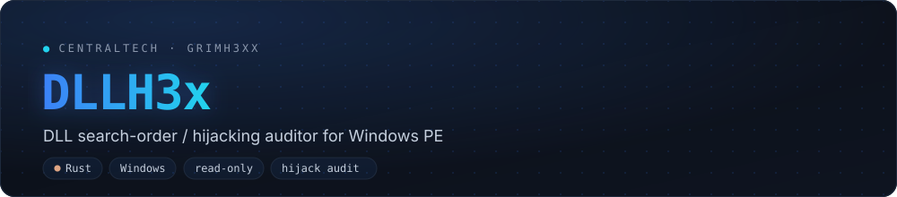

[](https://github.com/grimh3xx/DLLH3x/actions)
[](LICENSE)


**A read-only DLL search-order / hijacking auditor for Windows PE binaries, in Rust.**
It finds where the dynamic loader could resolve a dependency from a writable
directory — and tells you how to fix it. Strictly **diagnosis**: it never
generates, patches, plants, proxies, or executes a module.

<p align="center"></p>

## What it is

**DLLH3x** statically audits a PE's **import** and **delay-import** tables, models
the **Windows DLL search order**, follows the dependency tree for **transitive**
hijack chains, and reports which dependencies an attacker could satisfy by
dropping a module into a directory they can write to — graded by exploitability
and mapped to MITRE ATT&CK. Every finding comes with a concrete remediation, so
the output is actionable for defenders hardening their own software *and* for
authorized assessors writing up findings.

It is a **diagnostic tool**. DLLH3x opens files read-only and **never**
generates, patches, plants, proxies, or executes a DLL. There is no payload path
in this repository by design.

> Use it only on software you own or are explicitly authorized to assess.

## Features

- **PE import + delay-import parsing** — walks the standard import directory and
  the delay-load directory (data directory #13) by hand, so lazily-resolved
  side-loading surfaces are not missed.
- **Real Windows search-order model** — classifies every module against
  KnownDLLs, the API-set schema, and System32.
- **Bitness-aware resolution** — x86 targets are resolved against **SysWOW64**,
  x64 against **System32**, based on the PE machine type (`--wow64-root`).
- **SxS / manifest awareness** — reads the embedded `RT_MANIFEST` or external
  `.manifest`, so `<file>`-redirected assemblies are recognized instead of being
  mis-flagged as phantoms — and still flagged when the directory is writable.
- **Live or baseline system index** — reads a real `System32` on Windows (or via
  `--system-root` from WSL); falls back to a labelled built-in baseline off-Windows.
- **Transitive hijack chains** — follows the dependency tree through app-local
  modules to find phantom/shadowing slots **at depth ≥ 1** that a direct scan
  never surfaces (`app.exe → plugin.dll → codec.dll`). `--graph` renders the
  ASCII tree; `--dot` exports Graphviz.
- **Write exposure (ACL)** — on Windows, parses `icacls` to name the
  low-privilege principals (`BUILTIN\Users`, `Authenticated Users`, …) that can
  write to the install directory; elsewhere falls back to a write probe.
- **Signature & DotLocal signals** — detects unsigned app-local modules
  (Authenticode certificate table) and `<binary>.local` DotLocal redirection.
- **Exploitability + MITRE ATT&CK** — a 0–1 confidence per finding combining
  every signal, mapped to `T1574.001` (search-order) / `T1574.002` (side-loading).
- **Risk scoring** — per-module risk (`info`→`critical`) plus a 0–100 surface
  score for the whole binary. **imphash** for triage and threat-intel pivoting.
- **Four outputs** — colored terminal, JSON, **SARIF 2.1.0** (GitHub code
  scanning), and a self-contained **HTML** report in the house theme.
- **CI gate & batch** — `--fail-on <level>` blocks a build; `--recursive` sweeps
  a whole install tree.

## Install

```bash
git clone https://github.com/grimh3xx/DLLH3x
cd DLLH3x
cargo build --release
# binary at ./target/release/dllh3x
```

## Usage

```text
dllh3x <PATH> [OPTIONS]

  -r, --recursive         recurse into directories
  -j, --json              emit JSON instead of the terminal report
      --sarif             emit SARIF 2.1.0 (for GitHub code scanning)
      --html <FILE>       also write a self-contained HTML report
  -o, --output <FILE>     write the (JSON/SARIF) report to a file
      --min-risk <LEVEL>  only show findings >= info|low|medium|high|critical  [default: low]
      --system-root <DIR> live System32 for 64-bit targets (WSL: /mnt/c/Windows/System32)
      --wow64-root <DIR>  live SysWOW64 for 32-bit targets (WSL: /mnt/c/Windows/SysWOW64)
      --graph             print the transitive dependency graph (ASCII tree)
      --dot <FILE>        export the dependency graph as Graphviz DOT
      --fail-on <LEVEL>   exit non-zero if any finding reaches this risk (CI gate)
  -v, --verbose           show every reason and remediation line
      --no-color          disable ANSI colors
```

### Examples

```bash
# Audit one binary, show only real exposure
dllh3x "C:\Program Files\Vendor\app.exe" --min-risk high

# From WSL, point the index at the live Windows System32 (+ SysWOW64 for x86)
dllh3x ./app.exe --system-root /mnt/c/Windows/System32 \
                 --wow64-root  /mnt/c/Windows/SysWOW64 -v

# Sweep an install tree and fail a pipeline on any critical finding
dllh3x "C:\Program Files\Vendor" --recursive --fail-on critical

# See deep hijack chains through app-local modules
dllh3x "C:\Program Files\Vendor" --graph

# SARIF for GitHub code scanning, plus a shareable HTML report
dllh3x "C:\Program Files\Vendor" --recursive --sarif -o dllh3x.sarif --html report.html
```

## How it works

For each imported module, DLLH3x asks *where would the loader find this?* and
assigns a classification:

| Classification | Meaning | Default risk |
|----------------|---------|--------------|
| `known-dll`    | In the `\KnownDlls` object directory — always from System32 | info |
| `api-set`      | `api-ms-win-*` / `ext-ms-*`, resolved by the API-set schema | info |
| `system-dll`   | Present in System32; loaded there under SafeDllSearchMode | info *(low if dir writable)* |
| `app-local`    | A private module shipped next to the binary | low |
| `manifest-redirected` | Pinned app-local by a SxS manifest `<file>` entry | low → **medium** if writable, **high** if the declared file is missing |
| `shadowing`    | App-local module whose name also exists in System32 | high → **critical** if writable |
| `phantom`      | **Not** in the system dir and **absent** from the app dir — an empty slot | high → **critical** if writable |

The application directory is first in the search order for the executable's own
imports, so a **writable** directory is what escalates a `phantom` or `shadowing`
candidate to **critical**: a non-privileged user could simply drop a file there.

**Bitness matters.** A 32-bit (x86) image on 64-bit Windows resolves its system
DLLs from **SysWOW64**, not System32. DLLH3x detects the target's machine type
and resolves each binary against the correct system directory — pass
`--wow64-root` so x86 targets are checked against a real SysWOW64 index instead
of falling back to the System32 name set. Findings tagged `[wow64]` were resolved
this way.

### Transitive chains (the part other scanners miss)

Direct imports are only the first layer. An app-local module loads *its own*
imports from the same application directory, so a hijackable slot can sit two or
three hops deep where no direct scan looks:

```text
app.exe
 └─ plugin.dll   (app-local, unsigned)
      └─ codec.dll   ← phantom (depth 2)
```

DLLH3x walks the tree through app-local / shadowing / manifest-redirected modules
(system and KnownDLL modules resolve their own dependencies from the protected
system directory, so they are leaves) and reports every hijack point reached at
depth ≥ 1 as a **transitive chain**. `--graph` prints the whole tree; `--dot`
exports it for Graphviz.

### Exploitability & ATT&CK

Beyond a risk bucket, each finding gets an **exploitability** estimate (0–1)
combining classification, write exposure, named ACL writers, DotLocal, signature
state and delay-load, plus a MITRE ATT&CK mapping — `T1574.001` (DLL Search-Order
Hijacking) or `T1574.002` (DLL Side-Loading).

### Risk scoring

Each finding carries a score; the binary's **surface score** (0–100) is weighted
so a single critical dominates while a long tail of low findings cannot inflate
it. A clean, fully-system-resolved binary scores near zero.

## Example output (JSON)

```json
{
  "target": "lghub.exe",
  "arch": "x64 (AMD64)",
  "imphash": "8cabe7ef2165f2dc825863391fe3251c",
  "app_dir_writable": true,
  "app_dir_writers": ["BUILTIN\\Users"],
  "dotlocal": false,
  "target_signed": true,
  "index_source": "live",
  "system_dir": "C:\\Windows\\System32",
  "wow64_resolution": false,
  "manifest": { "source": "embedded", "redirected_files": [], "dependencies": ["Microsoft.Windows.Common-Controls"] },
  "transitive_chains": [ { "path": ["plugin.dll", "codec.dll"], "leaf": "phantom", "depth": 1 } ],
  "surface_score": 100,
  "counts": { "critical": 1, "high": 0, "medium": 0, "low": 34, "info": 22, "total": 57 },
  "findings": [
    {
      "dll": "ffmpeg.dll",
      "import_kind": "delay",
      "classification": "phantom_dll",
      "risk": "critical",
      "score": 95,
      "exploitability": 0.91,
      "confidence": "high",
      "attack": ["T1574.001"],
      "reasons": ["ffmpeg.dll is not in the system directory (System32) and is absent from the application directory ..."],
      "remediation": ["Do not import ffmpeg.dll by bare name; resolve it with an explicit, validated path.", "..."]
    }
  ]
}
```

## Scope & ethics

DLLH3x is a defensive / audit tool and deliberately stops at diagnosis:

- ✅ Parse imports, model the search order, score exposure, suggest fixes.
- ❌ Generate or template a malicious/proxy DLL, inject a payload, plant a file,
  or achieve execution.

If you need to *exploit* a finding during an authorized engagement, that step
stays in your own tooling and your rules of engagement — it is not part of this
project.

## Roadmap

- [x] SysWOW64 resolution for 32-bit targets
- [x] SxS / activation-context (manifest) `<file>` redirection awareness
- [x] Transitive dependency-graph hijack chains (`--graph` / `--dot`)
- [x] Write-exposure ACLs, Authenticode signal, DotLocal detection
- [x] Exploitability scoring + MITRE ATT&CK mapping
- [x] SARIF output + self-contained HTML report
- [ ] Full Authenticode **trust-chain** validation (Windows runtime)
- [ ] SxS `<dependentAssembly>` WinSxS resolution

## License

MIT — see [LICENSE](LICENSE).
