<h1 align="center">DLLH3x</h1>

<p align="center">
  <b>Read-only DLL search-order / hijacking auditor for Windows PE binaries.</b><br>
  Finds where the dynamic loader could resolve a dependency from a writable
  directory — and tells you how to fix it. Diagnosis only, never weaponization.
</p>

<p align="center">
  
  
  
  
  
  
</p>

<p align="center">
  
</p>

---

## What it is

**DLLH3x** statically audits a PE's **import** and **delay-import** tables, models
the **Windows DLL search order**, and reports which dependencies an attacker could
satisfy by dropping a module into a directory they can write to. Every finding
comes with a concrete remediation, so the output is actionable for defenders
hardening their own software *and* for authorized assessors writing up findings.

It is a **diagnostic tool**. DLLH3x opens files read-only and **never**
generates, patches, plants, proxies, or executes a DLL. There is no payload path
in this repository by design.

> Use it only on software you own or are explicitly authorized to assess.

## Features

- **PE import + delay-import parsing** — walks the standard import directory and
  the delay-load directory (data directory #13) by hand, so lazily-resolved
  side-loading surfaces are not missed.
- **Real Windows search-order model** — classifies every module against
  KnownDLLs, the API-set schema, and System32.
- **Live or baseline system index** — reads a real `System32` on Windows (or via
  `--system-root` from WSL); falls back to a labelled built-in baseline off-Windows.
- **Writability probe** — flags when the binary's directory is writable, which is
  what turns a candidate into live exposure.
- **Risk scoring** — per-module risk (`info`→`critical`) plus a 0–100 surface
  score for the whole binary.
- **imphash** — Mandiant-style import hash for triage and threat-intel pivoting.
- **Two outputs** — a colored terminal report and machine-readable JSON.
- **CI gate** — `--fail-on <level>` exits non-zero so a build can block on
  regressions.
- **Batch mode** — scan a whole directory tree with `--recursive`.

## Install

```bash
git clone https://github.com/grimh3xx/DLLH3x
cd DLLH3x
cargo build --release
# binary at ./target/release/dllh3x
```

## Usage

```text
dllh3x <PATH> [OPTIONS]

  -r, --recursive         recurse into directories
  -j, --json              emit JSON instead of the terminal report
  -o, --output <FILE>     write the (JSON) report to a file
      --min-risk <LEVEL>  only show findings >= info|low|medium|high|critical  [default: low]
      --system-root <DIR> live System32 for 64-bit targets (WSL: /mnt/c/Windows/System32)
      --wow64-root <DIR>  live SysWOW64 for 32-bit targets (WSL: /mnt/c/Windows/SysWOW64)
      --fail-on <LEVEL>   exit non-zero if any finding reaches this risk (CI gate)
  -v, --verbose           show every reason and remediation line
      --no-color          disable ANSI colors
```

### Examples

```bash
# Audit one binary, show only real exposure
dllh3x "C:\Program Files\Vendor\app.exe" --min-risk high

# From WSL, point the index at the live Windows System32 (+ SysWOW64 for x86)
dllh3x ./app.exe --system-root /mnt/c/Windows/System32 \
                 --wow64-root  /mnt/c/Windows/SysWOW64 -v

# Sweep an install tree and fail a pipeline on any critical finding
dllh3x "C:\Program Files\Vendor" --recursive --fail-on critical

# Machine-readable report for a dashboard
dllh3x ./app.exe --json -o report.json
```

## How it works

For each imported module, DLLH3x asks *where would the loader find this?* and
assigns a classification:

| Classification | Meaning | Default risk |
|----------------|---------|--------------|
| `known-dll`    | In the `\KnownDlls` object directory — always from System32 | info |
| `api-set`      | `api-ms-win-*` / `ext-ms-*`, resolved by the API-set schema | info |
| `system-dll`   | Present in System32; loaded there under SafeDllSearchMode | info *(low if dir writable)* |
| `app-local`    | A private module shipped next to the binary | low |
| `shadowing`    | App-local module whose name also exists in System32 | high → **critical** if writable |
| `phantom`      | **Not** in System32 and **absent** from the app dir — an empty slot | high → **critical** if writable |

The application directory is first in the search order for the executable's own
imports, so a **writable** directory is what escalates a `phantom` or `shadowing`
candidate to **critical**: a non-privileged user could simply drop a file there.

**Bitness matters.** A 32-bit (x86) image on 64-bit Windows resolves its system
DLLs from **SysWOW64**, not System32. DLLH3x detects the target's machine type
and resolves each binary against the correct system directory — pass
`--wow64-root` so x86 targets are checked against a real SysWOW64 index instead
of falling back to the System32 name set. Findings tagged `[wow64]` were resolved
this way.

### Risk scoring

Each finding carries a score; the binary's **surface score** (0–100) is weighted
so a single critical dominates while a long tail of low findings cannot inflate
it. A clean, fully-system-resolved binary scores near zero.

## Example output (JSON)

```json
{
  "target": "lghub.exe",
  "arch": "x64 (AMD64)",
  "imphash": "8cabe7ef2165f2dc825863391fe3251c",
  "app_dir_writable": true,
  "index_source": "live",
  "system_dir": "C:\\Windows\\System32",
  "wow64_resolution": false,
  "surface_score": 100,
  "counts": { "critical": 1, "high": 0, "medium": 0, "low": 34, "info": 22, "total": 57 },
  "findings": [
    {
      "dll": "ffmpeg.dll",
      "import_kind": "delay",
      "classification": "phantom_dll",
      "risk": "critical",
      "score": 95,
      "reasons": ["ffmpeg.dll is not in System32 and is absent from the application directory ..."],
      "remediation": ["Do not import ffmpeg.dll by bare name; resolve it with an explicit, validated path.", "..."]
    }
  ]
}
```

## Scope & ethics

DLLH3x is a defensive / audit tool and deliberately stops at diagnosis:

- ✅ Parse imports, model the search order, score exposure, suggest fixes.
- ❌ Generate or template a malicious/proxy DLL, inject a payload, plant a file,
  or achieve execution.

If you need to *exploit* a finding during an authorized engagement, that step
stays in your own tooling and your rules of engagement — it is not part of this
project.

## Roadmap

- [x] SysWOW64 resolution for 32-bit targets
- [ ] SxS / activation-context (manifest) redirection awareness
- [ ] Application-manifest `<file>` redirection parsing
- [ ] SARIF output for code-scanning integrations
- [ ] Optional authenticode signature check on resolved modules

## License

MIT — see [LICENSE](LICENSE).
